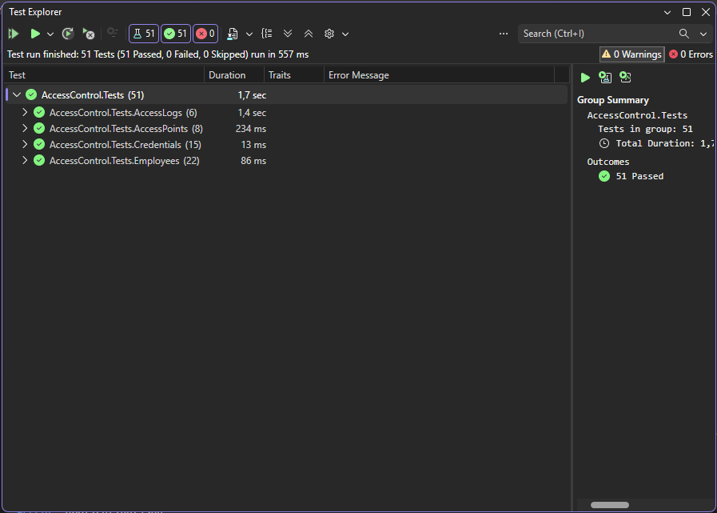
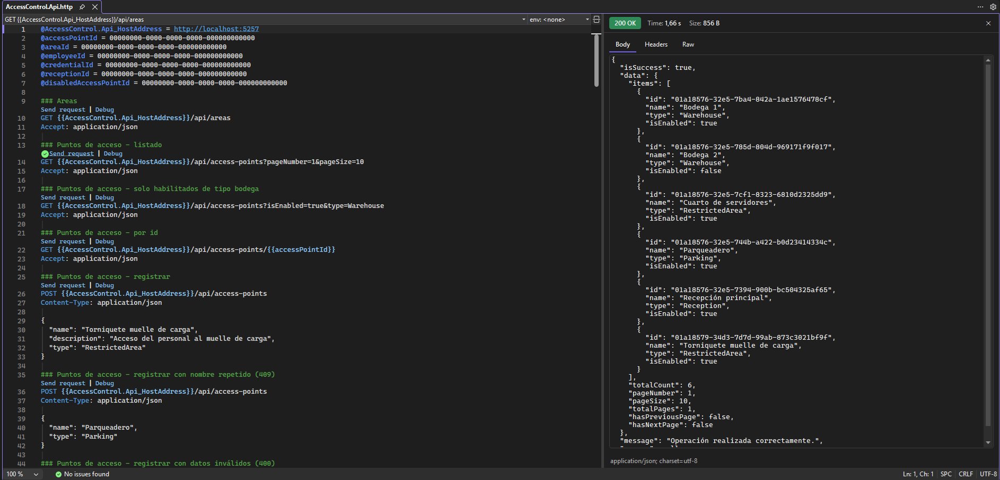
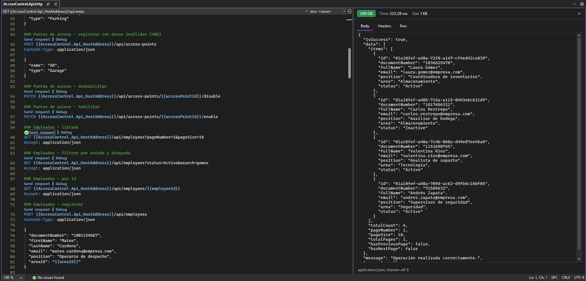
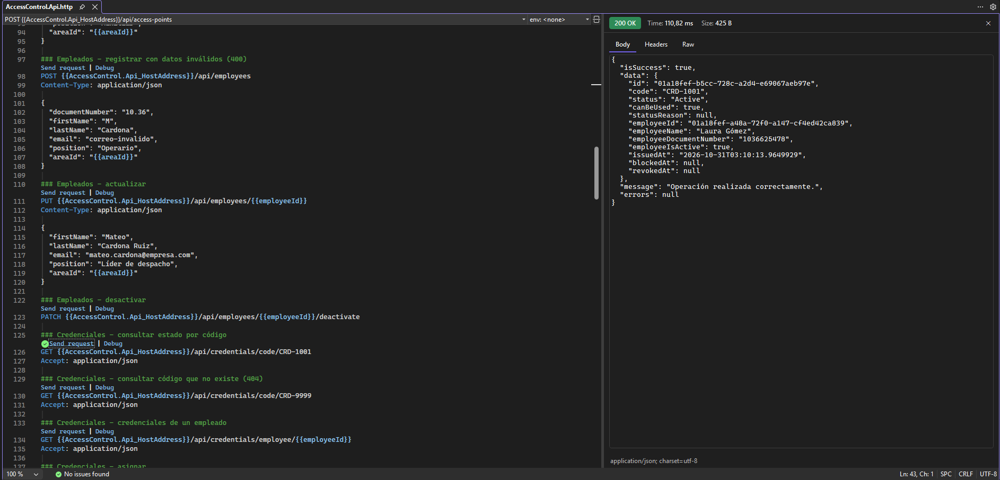
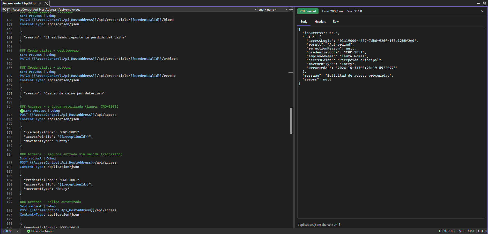
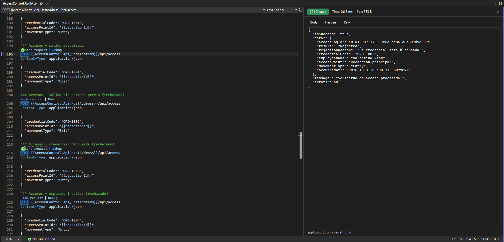
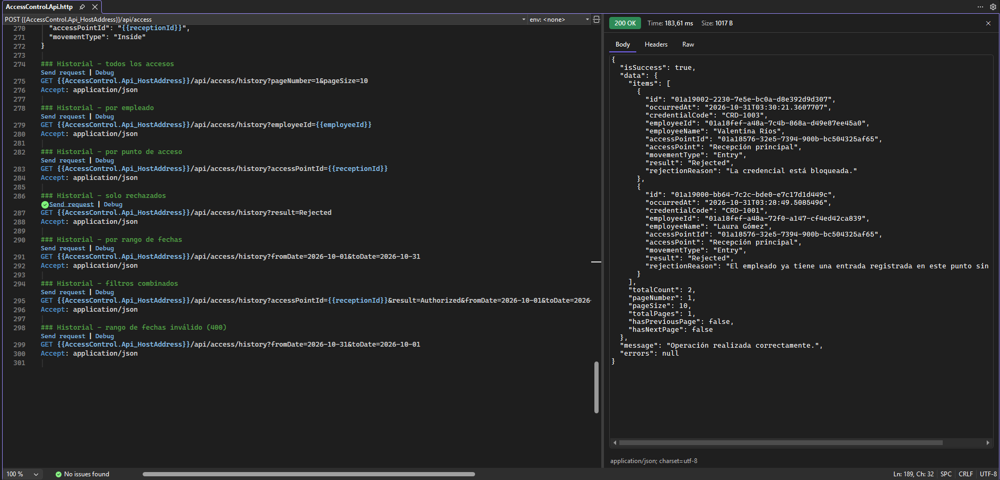

# Sistema de Gestión y Control de Acceso de Empleados (SGCAE)

Backend en ASP.NET Core Web API para administrar los empleados de una empresa de servicios logísticos y de almacenamiento, sus credenciales de acceso, los puntos de acceso de la sede y el registro de entradas y salidas, incluyendo los intentos rechazados.

Seguimiento 2 - Programación Distribuida - ITM
Oscar Alexis Pineda Henao

## Tecnologías

- .NET 10 / ASP.NET Core Web API
- Entity Framework Core 10 con SQL Server
- FluentValidation
- MSTest para las pruebas unitarias

## Arquitectura

La solución sigue Clean Architecture y está organizada así:

```
AccessControl.slnx
├── Core
│   ├── AccessControl.Domain          Entidades, objetos de valor, enums y reglas de negocio
│   └── AccessControl.Application     Casos de uso (comandos y consultas), validaciones y contratos
├── Infrastructure
│   └── AccessControl.Persistence     DataContext, configuraciones de EF Core, repositorios, migraciones y seeders
├── Presenters
│   └── AccessControl.Api             Controladores, DTOs de entrada y formato de respuesta
└── Tests
    └── AccessControl.Tests           Pruebas unitarias del dominio
```

- **Domain** no depende de ninguna otra capa. Las entidades tienen setters privados y validan sus propias reglas al crearse o cambiar de estado (por ejemplo, no se puede desbloquear una credencial revocada ni actualizar un empleado inactivo).
- **Objetos de valor:** `Email` y `DocumentNumber` como records inmutables.
- **CQRS:** cada caso de uso es un comando o una consulta con su propio handler, enviado a través de un mediador. Las validaciones con FluentValidation se ejecutan antes del handler.
- **Result pattern:** los handlers devuelven `Result` / `Result<T>` y la API traduce el tipo de error al código HTTP (400, 404, 409, 500).
- **Repositorios y Unit of Work:** los repositorios preparan los cambios y `IUnitOfWork.CommitAsync` los guarda en la base de datos.

## Requisitos

- .NET SDK 10
- SQL Server (local o LocalDB)
- Visual Studio 2026 o VS Code
- Herramienta de EF Core: `dotnet tool install --global dotnet-ef`

## Cómo ejecutar

1. Clonar el repositorio:

   ```bash
   git clone https://github.com/AlexisPineda21/Seguimiento2-ControlAcceso.git
   cd Seguimiento2-ControlAcceso
   ```

2. Revisar la cadena de conexión en `AccessControl.Api/appsettings.json`. Por defecto usa la instancia local de SQL Server con autenticación de Windows:

   ```json
   "DefaultConnection": "Server=.;Database=AccessControlDb;Trusted_Connection=True;TrustServerCertificate=True"
   ```

3. Crear la base de datos aplicando las migraciones (desde la raíz del repositorio):

   ```bash
   .\ef.cmd update
   ```

   o directamente con dotnet ef:

   ```bash
   dotnet ef database update --project AccessControl.Persistence --startup-project AccessControl.Api
   ```

4. Ejecutar la API:

   ```bash
   dotnet run --project AccessControl.Api --launch-profile http
   ```

   La API queda en `http://localhost:5257`. Al iniciar se cargan datos de prueba si las tablas están vacías.
   El documento OpenAPI está disponible en `http://localhost:5257/openapi/v1.json` (entorno Development).

5. Probar los endpoints con el archivo `AccessControl.Api/AccessControl.Api.http` desde Visual Studio o con la extensión REST Client de VS Code. Antes de enviar las peticiones hay que reemplazar las variables del inicio del archivo (`@employeeId`, `@receptionId`, etc.) por los ids que devuelven los listados.

## Datos de prueba

| Tipo | Datos |
|---|---|
| Áreas | Administración, Operaciones logísticas, Almacenamiento, Seguridad, Talento humano, Tecnología |
| Puntos de acceso | Recepción principal, Parqueadero, Bodega 1, Cuarto de servidores (habilitados) y Bodega 2 (deshabilitado) |
| Empleados | Laura Gómez, Andrés Zapata, Valentina Ríos (activos) y Carlos Restrepo (inactivo) |
| Credenciales | CRD-1001 Laura (activa), CRD-1002 Andrés (activa), CRD-1003 Valentina (bloqueada), CRD-1004 Carlos (activa, pero el empleado está inactivo) |

## Endpoints

Todas las respuestas tienen el mismo formato:

```json
{
  "isSuccess": true,
  "data": { },
  "message": "...",
  "errors": []
}
```

### Áreas

| Método | Ruta | Descripción |
|---|---|---|
| GET | `/api/areas` | Lista las áreas de la organización |

### Puntos de acceso (RF-06)

| Método | Ruta | Descripción |
|---|---|---|
| GET | `/api/access-points?pageNumber=1&pageSize=10&isEnabled=true&type=Warehouse` | Listado paginado, filtra por habilitado y tipo |
| GET | `/api/access-points/{id}` | Detalle de un punto de acceso |
| POST | `/api/access-points` | Registra un punto de acceso |
| PATCH | `/api/access-points/{id}/enable` | Habilita el punto |
| PATCH | `/api/access-points/{id}/disable` | Deshabilita el punto |

### Empleados (RF-01)

| Método | Ruta | Descripción |
|---|---|---|
| GET | `/api/employees?pageNumber=1&pageSize=10&areaId=&status=Active&search=` | Listado paginado con filtros |
| GET | `/api/employees/{id}` | Detalle de un empleado |
| POST | `/api/employees` | Registra un empleado |
| PUT | `/api/employees/{id}` | Actualiza los datos de un empleado activo |
| PATCH | `/api/employees/{id}/deactivate` | Desactiva un empleado |

### Credenciales (RF-02)

| Método | Ruta | Descripción |
|---|---|---|
| GET | `/api/credentials/code/{code}` | Consulta una credencial y su estado por código |
| GET | `/api/credentials/employee/{employeeId}` | Credenciales de un empleado |
| POST | `/api/credentials` | Asigna una credencial a un empleado activo |
| PATCH | `/api/credentials/{id}/block` | Bloquea la credencial (requiere motivo) |
| PATCH | `/api/credentials/{id}/unblock` | Desbloquea la credencial |
| PATCH | `/api/credentials/{id}/revoke` | Revoca la credencial (requiere motivo) |

### Registro de accesos (RF-03)

| Método | Ruta | Descripción |
|---|---|---|
| POST | `/api/access` | Procesa una solicitud de entrada o salida |

```json
{
  "credentialCode": "CRD-1001",
  "accessPointId": "id-del-punto-de-acceso",
  "movementType": "Entry"
}
```

Toda solicitud queda registrada, autorizada o rechazada. Se rechaza cuando:

- la credencial no existe, está bloqueada o está revocada
- el empleado está inactivo
- el punto de acceso está deshabilitado
- se intenta registrar una entrada cuando el empleado ya tiene una entrada sin salida en ese punto
- se intenta registrar una salida sin una entrada previa en ese punto

Si el punto de acceso no existe se responde 404 y no se guarda el registro.

### Historial de accesos (RF-04)

| Método | Ruta | Descripción |
|---|---|---|
| GET | `/api/access/history` | Historial paginado, del más reciente al más antiguo |

Filtros opcionales: `employeeId`, `accessPointId`, `fromDate`, `toDate` (formato `yyyy-MM-dd`, fechas en UTC), `result` (`Authorized` o `Rejected`), `pageNumber` y `pageSize` (máximo 50).

```
GET /api/access/history?employeeId={id}&fromDate=2026-10-01&toDate=2026-10-31&result=Rejected&pageNumber=1&pageSize=10
```

## Pruebas unitarias

Las pruebas están en `AccessControl.Tests` y cubren las reglas del dominio: empleados, objetos de valor, credenciales, puntos de acceso y registros de acceso.

```bash
dotnet test
```

## Evidencias

Pruebas unitarias:



Puntos de acceso:



Listado de empleados:



Consulta del estado de una credencial:



Acceso autorizado:



Acceso rechazado por credencial bloqueada:



Historial de accesos filtrado por resultado:


